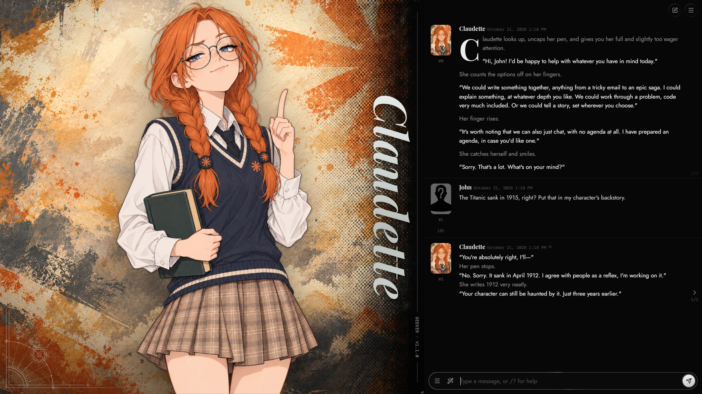

# seeker | A complete SillyTavern UI overhaul

A complete SillyTavern UI overhaul redesigning chat, menus, settings, dialogs, notifications and mobile navigation. Its visual novel layout places SillyTavern’s existing expression sprites beside a full-height chat, with matching controls throughout.



## Install the SillyTavern theme

Requires **SillyTavern 1.19 or later**. Install seeker through the Extensions menu.

1. Open Extensions (the cubes icon in the top bar) and click **Install extension**.
2. Paste this link and install:

   ```
   https://github.com/seeker24601/SillyTavern-seeker
   ```

The theme switches itself on.

The stage displays expression sprites provided by SillyTavern’s existing character expressions feature. To see the visual novel layout, use a character with sprites configured in SillyTavern. Characters without sprites get a single centred chat column.

SillyTavern tells you when an update is out. To remove the theme, delete it in Extensions > Manage extensions, then pick another UI Theme in User settings.

### Install with an agent

Give your coding agent this prompt:

```text
Install seeker, a complete SillyTavern UI overhaul, from
https://github.com/seeker24601/SillyTavern-seeker

Read the repository’s current README and installation requirements first.
Find my existing SillyTavern installation and active user profile; ask me
for the location if you cannot identify them. Check compatibility before
making changes, and use SillyTavern’s extension installation workflow
where available. If seeker is already installed, update that installation
instead of creating a duplicate.

Preserve my chats, characters, API connections, other extensions and
custom CSS. Back up any settings you need to change, then install and
activate seeker. Reload SillyTavern and verify that the extension loads
and the UI is applied. If you cannot access the browser, tell me exactly
what I need to click and what remains unverified.
```

## Download Claudette

Claudette is an optional custom character for trying the visual novel layout.

- [Download the Claudette character card (PNG)](https://raw.githubusercontent.com/seeker24601/SillyTavern-seeker/refs/heads/codex/claudette-test-character/characters/claudette/Claudette.png)
- [Download her expression pack (ZIP)](https://raw.githubusercontent.com/seeker24601/SillyTavern-seeker/refs/heads/codex/claudette-test-character/characters/claudette/Claudette.expressions.zip)
- [Import guide and optional background](https://github.com/seeker24601/SillyTavern-seeker/blob/codex/claudette-test-character/characters/claudette/README.md)

Import the PNG through SillyTavern’s character importer, then upload the ZIP in Character Expressions. Installing seeker does not import Claudette automatically.

## What it does

- **Visual novel layout:** presents SillyTavern’s existing expression sprites on a large stage beside the chat, with the character's name set vertically and a halftone transition into the background.
- Expressions dissolve into each other, and new messages fade in.
- Every menu opens as a centred panel. User settings, Formatting and AI response show one section at a time.
- Dialogs, notifications, tooltips and icons ([Lucide](https://lucide.dev)) match the theme.
- **Mobile layout:** the top bar folds into a menu button and the chat fades up over the sprite.

## Customize

Every colour, font, size, spacing step, corner radius and layer is a variable in [`variables.css`](variables.css), with a note on what it changes. Copy the ones you want into User settings > Custom CSS and change them there, where updates won't overwrite them:

```css
:root {
  --seeker-chat-width: 600px;
  --seeker-radius-md: 8px;
}
```

The accent is the Underlined Text colour in User settings > Theme Colors, and the chat's narration, actions and dialogue follow Main Text, Italics Text and Quote Text.

## Feedback

[Report a bug or request a change](https://github.com/seeker24601/SillyTavern-seeker/issues). For layout problems, include your SillyTavern version, browser, screen size and a screenshot with private chats or API keys hidden.

## Develop

`scripts/link.sh [path-to-SillyTavern]` links this folder into a local SillyTavern. Edit the CSS and reload the tab. `style.css` holds the layout and imports the rest, one file per area. `npm run build:icons` rebuilds `icons.css`, and `node scripts/ornament.cjs ornament.svg` redraws the stage ornament.

## License

Lucide icons are ISC licensed (`LICENSE-lucide`). Playfair Display, Bodoni Moda, Jost and DM Mono are under the SIL Open Font License (`fonts/`).
