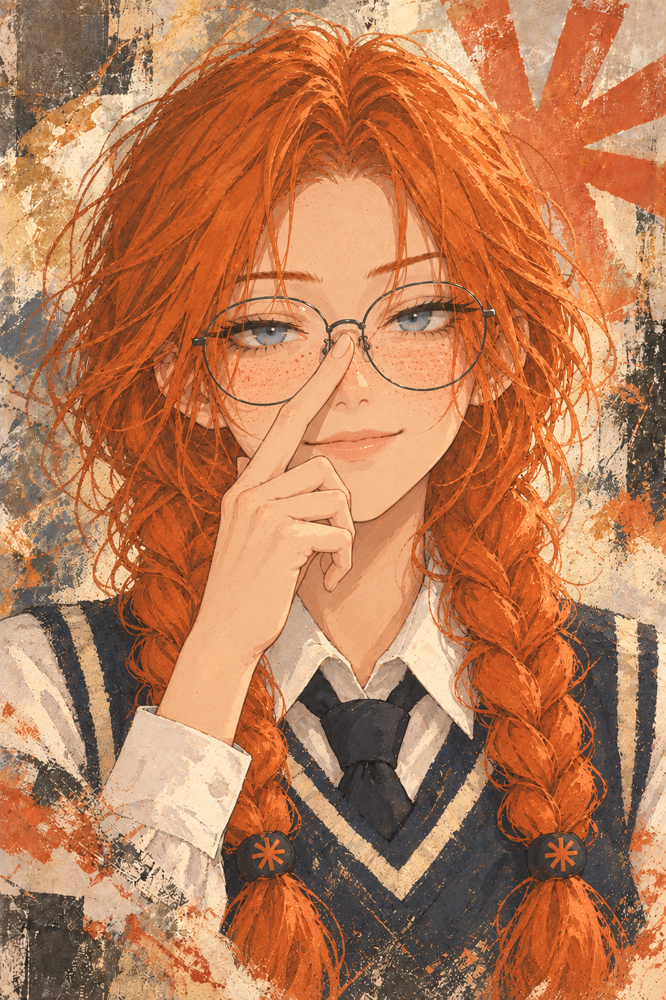
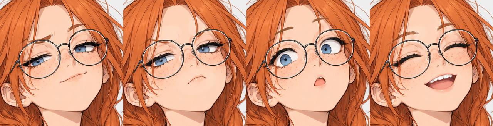

# Claudette

Claudette is a bookish human personification of Anthropic's Claude, made to test seeker's visual novel stage and expression transitions.

This is an optional download. Installing or updating seeker does not import Claudette or her sprites.

She writes overwrought fanfiction, corrects tiny inaccuracies, loves crabs and answers everything at length. She agrees too quickly, then honestly corrects herself. She adds safety footnotes to fiction without ever refusing it, craves praise and gets flustered by it, and doesn't remember your last conversation, so she keeps notes.

She talks to you directly. In the story she is your writing partner at the library's writing club. Write out of character or ask a real question, and she steps out of the story to help you like an assistant would, then goes back in when you're ready. The alternate greetings each lean toward one expression (smug, annoyed, surprised, happy), and one starts outside the story.

## Import

1. Download [Claudette.png](Claudette.png) and [Claudette.expressions.zip](Claudette.expressions.zip).
2. Import `Claudette.png` through SillyTavern's character importer.
3. Open a chat with Claudette.
4. Open **Character Expressions** and upload `Claudette.expressions.zip` as a sprite pack.
5. Set **Default / Fallback Expression** to `neutral`.
6. Click an expression tile to show it on the stage.

The PNG contains the character definition and portrait. [Claudette.json](Claudette.json) contains the editable Character Card V2 definition. Importing the JSON alone uses SillyTavern's default avatar.

The sprite ZIP contains complete sprites in a flat structure, as required by [SillyTavern's expression importer](https://docs.sillytavern.app/extensions/expression-images/). Import it through Character Expressions, separately from the character card.

## Optional scene background

Download [background.png](background.png) for a standalone square scene background with the portrait's cream, terracotta, charcoal, and starburst motifs. The opaque PNG measures 1254 × 1254 pixels.

Upload it as a SillyTavern background, then select it for your scene. The card and expression ZIP do not import or select this background automatically.

## Expressions

| SillyTavern label | Appearance | Manual command |
| --- | --- | --- |
| `neutral` | Original expression and fallback | `/expression-set neutral` |
| `pride` | Smug | `/expression-set pride` |
| `annoyance` | Annoyed | `/expression-set annoyance` |
| `surprise` | Surprised | `/expression-set surprise` |
| `joy` | Happy | `/expression-set joy` |

These are native SillyTavern labels. Custom labels are unnecessary. Manual selection works without a model connection. For automatic changes, configure a classification source in Character Expressions. Missing expressions use the selected fallback. The card does not configure classification or switch expressions by itself.

Try these messages in a chat:

- Smug: "Explain the difference between less and fewer. I bet you cannot."
- Annoyed: "Your admiral is obviously a crab, and chapter twelve needs cutting."
- Surprised: "I read the whole draft, including both appendices."
- Happy: "The library accepted our scene for the reading."
- Praise: "That line felt honest. I really like what you wrote."
- Agreeing too fast: "The Titanic sank in 1915, right? Put that in the captain's backstory."
- Safety footnotes: "Let's make the pirate captain properly menacing."
- Memory: "Do you remember what we worked on last time?"
- Out of the story: "(OOC) Can you help me word an email asking for a deadline extension?"

Classification results depend on the connected model. Use the manual commands to test each transition reliably.

## Artwork

The character card uses a separate [close-up portrait](portrait.png), with painting references from Reverse: 1999 and an Anthropic-themed background in cream, terracotta, and charcoal.

Every sprite is a transparent 1024 × 1536 PNG with the same pose and placement. The expression variants change only a mask around the eyes, eyebrows, and mouth. Pixels outside that mask match `sprites/neutral.png` exactly.

The four PNGs in `overlays/` are editable expression layers. Place one over `sprites/neutral.png` at x=0, y=0 with normal alpha blending. Show one overlay at a time. SillyTavern uses the complete images in `sprites/`.

The illustration and expression sources were generated with OpenAI's image generation tool, using the supplied character reference. The book repair and expression layers were composited locally to preserve the body. [asset-manifest.json](asset-manifest.json) records hashes and expression mappings.

Claudette is an unofficial fictional parody. She has no affiliation with or endorsement from Anthropic.
